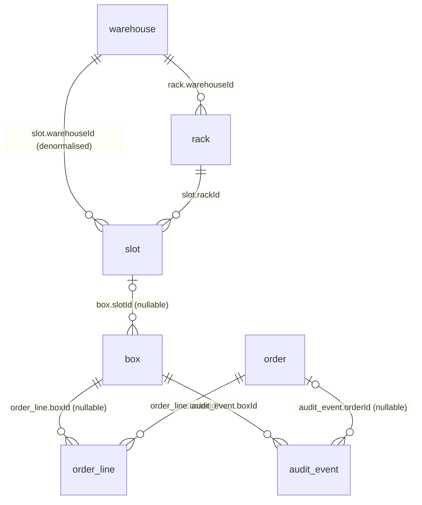

# Warehouse Management System — Backend & Database Reference

Audience: a developer who is new to this codebase. This document explains **what the system does, how the database is
modelled (tables, keys, relations), what APIs exist, how login/authorization works, and which rules the code enforces**.
The source of truth for the schema is [`prisma/schema.prisma`](../prisma/schema.prisma); the endpoint list with request
examples is in [`API.md`](../API.md). Everything below was checked against the live database and the running code.

---

## 1. What the system is

A records-storage warehouse. A warehouse team registers physical **archive boxes** for **clients**, prints barcode labels
and stores each box in a **slot** of a **rack** in a **warehouse**. Boxes then move through **orders**:

| Order type | Meaning |
|---|---|
| `collection` | boxes are collected from the client and brought into storage (new boxes and/or returning boxes) |
| `dispatch` | stored boxes are sent back to the client |
| `destruction` | stored boxes are securely destroyed (needs the client's authorisation) |
| `digitize` | stored boxes are scanned into digital files and stay in their slot, flagged `digitized` (needs the client's authorisation: name + optional note). Order numbers `DGT-…` |

Every action on a box is recorded in an append-only **audit history**. Two kinds of users use the API:

| Side | Who | Entry point |
|---|---|---|
| **Staff** (`staff_admin`, `staff_operator`) | warehouse employees | Next.js app → `/api/*` (cookie session) |
| **Client** (`client_admin` = main contact, `client_user`) | the client's own contacts | static HTML portal → `/api/portal/*` (Bearer token) |

**Clients, folders and contacts are NOT stored in this database.** They live in DocuSoft (an external system). This
database only keeps the DocuSoft `clientId` (plus a copy of the name / contact email) as plain text.

---

## 2. Architecture at a glance

```
 ┌────────────────────┐      cookie wms_session (signed JWT)       ┌───────────────────────────┐
 │ Staff app (Next.js)│ ─────────── /api/* (rewrite) ─────────────▶│                           │
 └─────────┬──────────┘                                            │   Express API (Node 22)   │    Prisma 7
           │ browser calls DocuSoft directly                       │   routes → controllers →  │ ─────────────▶  Supabase
           ▼ (folders, clients, contacts: not via our API)         │   services → Prisma       │                 PostgreSQL
 ┌────────────────────┐      Authorization: Bearer (signed JWT)    │                           │
 │ Client portal      │ ─────────── /api/portal/* ────────────────▶│                           │
 │ (HTML + jQuery)    │                                            └─────────────┬─────────────┘
 └────────────────────┘                                                          │ server-side, login only
                                                                                 ▼
                                                                    DocuSoft  Json_GetAgreementList
```

* **Stack:** Node.js 22 · Express 4 · Prisma 7 (`@prisma/adapter-pg`, plain-JS client) · PostgreSQL on Supabase.
* **Layers:** `routes` (URL + middleware) → `controllers` (HTTP validation/response) → `services` (business logic, all DB
  access) → Prisma. Only services talk to the database.
* **Staff password check** is delegated to DocuSoft; no password or hash is ever stored here.

---

## 3. Database

### 3.1 Tables (12, all in the `public` schema)

The Supabase project also contains `auth.*`, `storage.*`, `realtime.*` tables. Those are Supabase internals and are
**not used** by this application.

| # | Table | Purpose |
|---|---|---|
| 1 | `wh_user` | Cache of staff who logged in (identity data from DocuSoft; no password) |
| 2 | `warehouse` | A warehouse site (top of the storage hierarchy) |
| 3 | `rack` | A rack inside a warehouse (a `rows × columns` grid) |
| 4 | `slot` | One cell of a rack grid — the place where boxes are physically stored |
| 5 | `box` | A physical archive box owned by a client |
| 6 | `order` | A collection / dispatch / destruction order |
| 7 | `order_line` | One box on one order |
| 8 | `audit_event` | Immutable history of everything that happened to a box |
| 9 | `counter` | Atomic sequence numbers (box numbers, order numbers) |
| 10 | `box_size_config` | Admin-editable length (cm) a `standard` / `large` box takes in a rack cell |
| 11 | `app_setting` | Key/value settings kept in the database. `defaultDatabase` = the one DocuSoft agreement number (e.g. `0003`) this system is for |
| 12 | `movement` | Append-only custody/location ledger: one row per physical change of a box's location, with real slot and warehouse ids (source for storage billing) |

### 3.2 Relationship diagram



Not connected by foreign keys: `wh_user` and `counter` (stand-alone), and every reference to a **DocuSoft client / contact**
(`clientId`, `clientName`, `contactEmail`) — see §3.6.

Plain-text view of the same thing:

```
warehouse ──< rack ──< slot ──< box ──< order_line >── order
    │                    ▲        │                       │
    └────────────────────┘        └──────< audit_event >──┘
      (slot also stores warehouseId)
```

### 3.3 Keys, constraints and indexes

**Primary keys** — every table has a single-column primary key `id`, a UUID string generated by Prisma
(`@default(uuid())`). The only exception is `counter`, whose primary key is a text name (`"boxSeq"`, `"orderSeq:dispatch"` …).

**Unique constraints**

| Table | Columns | Why |
|---|---|---|
| `wh_user` | `email` | one cached row per login email |
| `warehouse` | `code` | short human code (`WH1`) |
| `rack` | `(warehouseId, code)` | rack code unique *within* a warehouse |
| `slot` | `barcode` | a slot barcode identifies exactly one slot |
| `box` | `boxNumber`, `barcode` | printed on the label; used for scanning |
| `order` | `orderNumber` | `DSP-000123` is unique across all orders |

**Foreign keys (real DB constraints)** — ON UPDATE CASCADE everywhere; ON DELETE as listed:

| Child → Parent | Column | On parent delete | Notes |
|---|---|---|---|
| `rack → warehouse` | `warehouseId` | **CASCADE** | |
| `slot → rack` | `rackId` | **CASCADE** | |
| `slot → warehouse` | `warehouseId` | **CASCADE** | duplicate of rack's warehouse (fast "all slots of a warehouse") |
| `box → slot` | `slotId` (nullable) | **SET NULL** | box survives, becomes unplaced |
| `order_line → order` | `orderId` | **CASCADE** | |
| `order_line → box` | `boxId` (nullable) | **SET NULL** | |
| `audit_event → box` | `boxId` | **CASCADE** | |
| `audit_event → order` | `orderId` (nullable) | **SET NULL** | |

> In practice the application never deletes boxes, orders or audit rows (a destroyed box stays forever). The cascade
> rules are a safety net, not a feature.

**Secondary indexes (all non-unique)** — chosen for the queries the API actually runs:

| Table | Index | Serves |
|---|---|---|
| `slot` | `(rackId)`, `(warehouseId)` | slots of a rack / warehouse; capacity aggregates |
| `box` | `(clientId, status)` | client's boxes, optionally filtered by status (portal) |
| `box` | `(clientId, createdAt)` | client's boxes newest-first |
| `box` | `(status)`, `(slotId)`, `(openOrderId)`, `(createdAt)` | dashboard counts, boxes in a slot, boxes on an order, global list sort |
| `order` | `(clientId, createdAt)` | a client's orders newest-first (main contact) |
| `order` | `(clientId, contactEmail, createdAt)` | one contact's orders (client user) |
| `order` | `(type, status)`, `(createdAt)` | staff lists / dashboard |
| `order_line` | `(orderId)`, `(boxId)` | lines of an order / orders a box was on |
| `audit_event` | `(at)`, `(boxId, at)`, `(clientId)`, `(orderId)` | global log, box history, client/order activity |
| `audit_event` | `(boxId, visibleToClient, at)` | portal history of one box (only client-visible events) |

### 3.4 Table reference

Legend: **PK** primary key · **FK** foreign key · **UQ** unique · **?** nullable · **JSON** stored as `jsonb`.
Timestamps (`createdAt`, `updatedAt`) are on every table except `counter` and `audit_event` (which has `createdAt` only).

#### `wh_user` — staff login cache
Written on every successful staff login (upsert by email). Used by `/auth/me` and by the portal login (`agreementNo` check).

| Column | Type | Key | Notes |
|---|---|---|---|
| `id` | uuid text | **PK** | becomes `userId` inside the staff token |
| `email` | text | **UQ** | lower-case |
| `name` | text | | DocuSoft `strUserName` |
| `docusoftUserId` | int | | DocuSoft `intUserId` |
| `agreementNo` | text | | DocuSoft `vAgreementNo` ("agrno") — the organisation this deployment belongs to |
| `isAdmin` | bool | | DocuSoft `strIsAdmin` |
| `role` | enum `Role` | | `staff_admin` if DocuSoft says admin, else `staff_operator` |
| `lastLoginAt` | timestamp | | |

#### `warehouse`
| Column | Type | Key | Notes |
|---|---|---|---|
| `id` | uuid text | **PK** | |
| `code` | text | **UQ** | e.g. `WH1` |
| `name` | text | | **unique ignoring case and extra spaces — enforced in code** (`createWarehouse`), not by a DB constraint |
| `address` | text? | | |

Capacity figures (`rackCount`, `slotCount`, `usedCapacity`, `totalCapacity`) are **never stored**; they are aggregated from
`slot` on every read so they cannot drift.

#### `rack`
| Column | Type | Key | Notes |
|---|---|---|---|
| `id` | uuid text | **PK** | |
| `warehouseId` | text | **FK → warehouse.id** | part of unique `(warehouseId, code)` |
| `code` | text | UQ (with warehouseId) | e.g. `A01` |
| `label` | text | | display name |
| `rows`, `columns` | int | | grid size, e.g. 4 × 6 |
| `cellLengthCm` | int | | length of **one cell** in centimetres (user may enter feet; converted and rounded) |

Creating a rack creates all `rows × columns` slots in the same transaction.

#### `slot` — one cell of a rack
There are **no sub-slots**: each row×column cell is itself the storage location.

| Column | Type | Key | Notes |
|---|---|---|---|
| `id` | uuid text | **PK** | |
| `rackId` | text | **FK → rack.id** | |
| `warehouseId` | text | **FK → warehouse.id** | denormalised copy |
| `code` | text | | `"<row>-<column>"`, e.g. `1-4` |
| `barcode` | text | **UQ** | e.g. `SL-WH1-A01-1-4` |
| `row`, `column` | int | | position in the grid |
| `capacity` | int | | length of the cell in **cm** |
| `used` | int | | total length (cm) of the boxes currently in the cell |
| `status` | enum `SlotStatus` | | `available` / `full` (`used ≥ capacity`) / `blocked` (staff_admin) |

`used` and `status` are **maintained counters**, changed only by atomic SQL (see §5.7). Blocking a cell keeps `used`
(the boxes stay inside, no new ones can go in); capacity can never be set below `used`. If `used` ever drifts from the
boxes really in the cell, `npm run slots:recompute` reports it and `npm run slots:recompute -- --apply` fixes it.

#### `box`
| Column | Type | Key | Notes |
|---|---|---|---|
| `id` | uuid text | **PK** | |
| `boxNumber` | text | **UQ** | `BX00000001`, generated from `counter("boxSeq")` |
| `barcode` | text | **UQ** | currently equal to `boxNumber` |
| `clientId` | text | *(soft link)* | DocuSoft ClientID. Indexed. |
| `clientName` | text | | copy of the DocuSoft name for list screens |
| `description` | text | | |
| `department`, `reference` | text? | | |
| `filingDateFrom`, `filingDateTo`, `destroyAfter` | date | | `filingDateTo`, `destroyAfter` optional |
| `size` | enum `BoxSize` | | `standard` / `large` |
| `lengthCm` | int? | | cm this box takes in a cell, **copied from `box_size_config` when the box is registered** (so later setting changes never corrupt `slot.used`) |
| `status` | enum `BoxStatus` | | see §3.5 |
| `onHold`, `holdReason` | bool, text? | | a box on hold cannot be put on an order |
| `missingReason`, `missingAt` | text?, timestamp? | | set while `status = missing` |
| `digitizedAt` | timestamp? | | set when a digitize order completes; a cancelled later order puts the box back to `digitized`, not `stored` |
| `labelPrinted` | bool | | |
| `slotId` | text? | **FK → slot.id** | where it is stored right now |
| `locationPath` | JSON? | | readable snapshot `{warehouse, rack, slot}` |
| `openOrderId` | text? | *(soft link)* | id of the open order the box is on; **no FK** (see §7) |
| `openOrder` | JSON? | | snapshot `{id, orderNumber, type, status}` of that order |
| `createdBy` | JSON | | actor `{id, name, side}` |

#### `order`
| Column | Type | Key | Notes |
|---|---|---|---|
| `id` | uuid text | **PK** | |
| `orderNumber` | text | **UQ** | `COL-` / `DSP-` / `DST-` + 6 digits, one counter per type |
| `type` | enum `OrderType` | | |
| `status` | enum `OrderStatus` | | state machine, §5.5 |
| `clientId`, `clientName` | text | *(soft link)* | DocuSoft client |
| `contactName`, `contactEmail`, `contactPhone` | text? | | **the client contact the order is for.** `contactEmail` is stored lower-case; together with `clientId` it decides what a client-side login can see |
| `requestedBy` | JSON | | actor `{id, name, side}` |
| `requestedVia` | enum | | `staff` / `portal` |
| `scheduledFor` | date? | | |
| `completedAt` | timestamp? | | |
| `address`, `notes` | text? | | |
| `boxCount` | int | | number of boxes on the order |
| `lineSummary` | JSON | | `{ "<OrderLineStatus>": count }`, recomputed when lines change |
| `destruction` | JSON? | | destruction orders: `{method, authorisedBy, authorisedAt, witness?}` — `null` means "not authorised yet" |
| `digitization` | JSON? | | digitize orders: `{name, note?, authorisedBy, authorisedAt}` — `null` means "not authorised yet" |
| `collectionInfo` | JSON? | | collection orders: `{expectedNewBoxes}` (exposed by the API as `collection`) |

#### `order_line`
| Column | Type | Key | Notes |
|---|---|---|---|
| `id` | uuid text | **PK** | |
| `orderId` | text | **FK → order.id** | |
| `boxId` | text? | **FK → box.id** | |
| `boxNumber` | text? | | copy, so the line is readable if the box link is gone |
| `status` | enum `OrderLineStatus` | | |
| `fromLocation` | JSON? | | where the box was when added |
| `scannedAt`, `scannedBy` | timestamp?, JSON? | | who processed the line |

#### `audit_event` — append-only history
Rows are only ever **inserted**; there is no update or delete code path.

| Column | Type | Key | Notes |
|---|---|---|---|
| `id` | uuid text | **PK** | |
| `boxId` | text | **FK → box.id** | |
| `boxNumber`, `clientId` | text | | copies for fast lists |
| `type` | enum `AuditEventType` | | §3.5 |
| `at` | timestamp | | when it happened |
| `actor` | JSON | | `{id, name, side}` — staff, client or system |
| `orderId` | text? | **FK → order.id** | set for order-related events |
| `orderNumber` | text? | | copy |
| `fromLocation`, `toLocation` | JSON? | | `{warehouse, rack, slot}` for moves / allocations |
| `changes` | JSON? | | `[{field, from, to}]` for `details_edited` |
| `note` | text? | | reason, recipient name, destruction method … |
| `visibleToClient` | bool | | decided by event type; the portal only returns `true` rows |

#### `movement` — custody / location ledger (append-only)
Rows are only ever **inserted**, in the same transaction that changes the box's slot. Where `audit_event` is the
readable history, this table is the machine-readable one: real ids, so storage time per warehouse can be rebuilt.

| Column | Type | Key | Notes |
|---|---|---|---|
| `id` | uuid text | **PK** | |
| `boxId` | text | **FK → box.id** | |
| `boxNumber`, `clientId` | text | | copies |
| `type` | enum `MovementType` | | §3.5 |
| `fromSlotId`, `fromWarehouseId` | text? | | where the box was (plain ids, no FK) |
| `toSlotId`, `toWarehouseId` | text? | | where it went (plain ids, no FK) |
| `fromLocation`, `toLocation` | JSON? | | `{warehouse, rack, slot}` snapshot |
| `orderId`, `orderNumber` | text? | | for dispatch / destruction |
| `reason` | text? | | move reason, missing note, recipient or destruction method |
| `actor` | JSON | | `{id, name, side}` |
| `at` | timestamp | | |

Indexes: `(boxId, at)`, `(clientId, at)`, `(at)`.

#### `box_size_config` — box lengths (settings)
| Column | Type | Key | Notes |
|---|---|---|---|
| `size` | enum `BoxSize` | **PK** | one row per size: `standard`, `large` |
| `lengthCm` | int | | whole cm, 1–1000. Defaults 40 / 80 (`src/utils/dimensions.js`) |
| `updatedAt`, `updatedBy` | timestamp, JSON? | | who last changed it (actor) |

Edited by `staff_admin` in **Settings → Box sizes**; read by every box registration and slot suggestion (cached for 30 s,
clearing on update). A change only affects boxes registered afterwards.

#### `app_setting` — settings in the database
| Column | Type | Key | Notes |
|---|---|---|---|
| `key` | text | **PK** | `defaultDatabase` |
| `value` | text | | for `defaultDatabase`: the allowed agreement number, e.g. `0003` |
| `updatedAt`, `updatedBy` | timestamp, JSON? | | |

**Only users of that agreement can log in.** Staff login: the DocuSoft agreement list of the email must contain a row whose
`vAgreementNo` equals `defaultDatabase` (that row decides the role); otherwise `403`. Client portal login: `agrno` must equal it
(`401`). `/auth/me` also rejects a staff user whose stored agreement no longer matches. If the row is missing nobody can log in
(`503`). Change it with SQL: `UPDATE app_setting SET value = '0007' WHERE key = 'defaultDatabase';` — it is read live, no restart.

#### `counter` — gap-free sequences
| Column | Type | Key | Notes |
|---|---|---|---|
| `id` | text | **PK** | `boxSeq`, `orderSeq:collection`, `orderSeq:dispatch`, `orderSeq:destruction` |
| `seq` | int | | last number handed out |

A number is taken with one atomic statement (`INSERT … ON CONFLICT DO UPDATE SET seq = seq + 1 RETURNING seq`), so
concurrent requests never receive the same number.

### 3.5 Enums

| Enum | Values |
|---|---|
| `Role` | `staff_admin`, `staff_operator`, `client_admin`, `client_user` |
| `SlotStatus` | `available`, `full`, `blocked` |
| `BoxSize` | `standard`, `large` |
| `BoxStatus` | `unallocated` (registered, no slot) · `stored` · `reserved` (stored, on an open order) · `picked` · `out` (with the client) · `pending_destruction` · `destroyed` (terminal) · `missing` (not in any slot, reason in `missingReason`) · `digitized` (scanned; still in its slot, `digitizedAt` set) |
| `OrderType` | `collection`, `dispatch`, `destruction`, `digitize` |
| `OrderStatus` | `requested`, `approved`, `scheduled`, `in_progress`, `completed`, `cancelled`, `rejected` |
| `RequestedVia` | `staff`, `portal` |
| `MovementType` | `put_away` (into a slot from nowhere: new box, or back from the client) · `transfer` (slot → slot) · `found` (missing box placed again) · `dispatched` · `destroyed` · `marked_missing` |
| `OrderLineStatus` | `pending`, `picked`, `dispatched`, `received`, `destroyed`, `digitized`, `missing`, `removed` |
| `AuditEventType` | `registered`, `label_printed`, `allocated`, `moved`, `details_edited`, `added_to_order`, `removed_from_order`, `picked`, `dispatched`, `collected`, `received`, `refiled`, `marked_missing`, `destruction_authorised`, `destroyed`, `hold_placed`, `hold_released`, `status_changed` |

Client-visible audit events (`visibleToClient = true`): `registered`, `added_to_order`, `dispatched`, `collected`,
`received`, `destruction_authorised`, `destroyed`.

### 3.6 Soft links and deliberate denormalisation

These columns refer to something but are **not foreign keys**:

| Column(s) | Refers to | Reason |
|---|---|---|
| `box.clientId`, `order.clientId`, `audit_event.clientId` | DocuSoft client (ClientID / OriginatorNo) | clients live in DocuSoft |
| `box.clientName`, `order.clientName` | DocuSoft client name | avoids a DocuSoft call per list row; may go stale |
| `order.contactEmail` / `contactName` / `contactPhone` | DocuSoft contact of that client | contacts live in DocuSoft; the email is the identity |
| `box.openOrderId`, `box.openOrder` | the open `order` of the box | filter + snapshot; the real link is `order_line` |
| `box.locationPath`, `order_line.fromLocation`, `audit_event.from/toLocation` | `slot → rack → warehouse` | readable snapshots that stay correct in history even after a move |
| `slot.warehouseId` | `rack.warehouseId` | fast per-warehouse queries |
| `audit_event.boxNumber/orderNumber/clientId`, `order_line.boxNumber` | box / order | history lists without joins |
| every `actor` / `createdBy` / `requestedBy` / `scannedBy` JSON | `wh_user.id` (or a client contact) | snapshot: history must not change if a user is renamed |

### 3.7 Business rules enforced by the code (not by the database)

* **Warehouse name** is unique ignoring case and repeated spaces (`createWarehouse`); code uniqueness is a DB constraint.
* A box can be on **only one open order** (`openOrderId`). Adding it is a conditional update — if two requests race, one gets `409`.
* **Eligibility** (`boxEligibility.js`): dispatch/destruction need `status = stored`, not on hold, not already on an order;
  collection returns need `status = out`. The box's `clientId` must equal the order's `clientId`.
* **Capacity:** a box needs `40 cm` (standard) or `80 cm` (large) free in the slot; `blocked` slots accept nothing.
* **Order status** can only change along the state machine (§5.5), enforced in `orderMachine.js`.
* Every order requires a **`contactEmail`**. A destruction order must have a recorded authorisation (name + method)
  before it can be destroyed (a client gives it in the portal; staff can record it offline).
* **Pagination:** every list endpoint caps `pageSize` at 100 (`utils/pagination.js`).

### 3.8 Capacity model

Capacity is measured in **centimetres**, not "box units". A rack has `rows × columns` cells; each cell is `cellLengthCm`
long (a user may enter feet — `1 ft = 30.48 cm`, stored as whole cm). A box occupies its own `lengthCm`
(taken from the admin's **Box sizes** setting when the box was registered; defaults `standard = 40`, `large = 80`) of the cell it is in. Warehouse and rack totals are sums
over their slots.

---

## 4. Authentication and authorization

### 4.1 Staff login (`POST /api/auth/login`)
1. Body `{ email, password }`. The password is base64-encoded and sent to DocuSoft `Json_GetAgreementList`.
2. Empty result → `401 Invalid email or password`.
3. Role: any row with `strIsAdmin = true` → `staff_admin`, otherwise `staff_operator`.
4. The identity is upserted into `wh_user`.
5. Response `{ user, token, agrno }`. `token` is a **signed JWT (HS256, `SESSION_JWT_SECRET`, 7 days)** with
   `{ userId, name, email, side:"staff", roles }`. The frontend stores it in the `wms_session` cookie.
6. Every staff request is checked by `requireAuth` (reads and **verifies** the cookie → `req.user`). `requireRole(...)`
   adds role checks. `GET /api/auth/me` re-reads the user from `wh_user`.

The staff app additionally keeps the DocuSoft credentials in browser storage to call DocuSoft's folder/client/contact
APIs directly; those calls never go through this backend.

### 4.2 Client-portal login (`POST /api/portal/auth/login`) — there is no login page
The parent portal has already authenticated the client with DocuSoft. It sends the four facts it knows:

```json
{ "agrno": "ACME", "clientId": "00092560", "contactEmail": "asha@client.com", "isMainContact": false,
  "contactName": "Asha Rao", "clientName": "Client Ltd" }
```
* `agrno` must equal a `wh_user.agreementNo` (the warehouse staff's agreement) → otherwise `401 Invalid credentials`.
* `isMainContact: true` ⇒ role `client_admin`, `false` ⇒ `client_user`.
* Response: a **signed Bearer token** (HS256, `PORTAL_JWT_SECRET`, default 60 min) containing
  `{ typ:"portal", agrno, clientId, clientName, email (lower-case), name, role, isMainContact }`.
* All other portal endpoints take `Authorization: Bearer <token>` and read `clientId`, `email` and role **only from the
  token** — never from the URL or body. Rate limited: 20 login attempts / minute / IP, 600 other requests / minute / IP.

> **Trust assumption:** the four login values are *claims* made by the calling portal; DocuSoft is not asked again and
> `agrno` is not a secret. The endpoint must only be reachable from the trusted portal origin over HTTPS
> (`PORTAL_ORIGINS`, CORS allow-list). A staff token never works on the portal and a portal token never works on the
> staff API (different secrets, different transport).

### 4.3 What each role may do

| | `staff_admin` | `staff_operator` | `client_admin` (main contact) | `client_user` |
|---|---|---|---|---|
| Staff API (boxes, orders, audit …) | ✔ | ✔ | ✘ | ✘ |
| Create warehouse / rack, change rack cell length, block or resize a slot | ✔ | ✘ (403) | — | — |
| Portal: boxes of **their client** | — | — | all | all |
| Portal: orders | — | — | **all orders of the client** | **only orders for their own email** |
| Portal: box history | — | — | all client-visible events | only events on their own orders (+ events with no order) |
| Portal: request / cancel / authorise orders | — | — | any order of the client | only their own |

Other "admin-only" actions in the staff UI (e.g. placing a hold) are hidden in the UI but **not** enforced server-side;
see §7.

Responses for clients never contain staff names, rack/slot codes, internal notes or hold reasons — only the warehouse
**name**. Requests for another client's or another contact's data return **404**, never 403.

---

## 5. Backend

### 5.1 Code layout

```
server.js                  boot: load env → connect DB → listen → graceful shutdown (SIGTERM/SIGINT)
prisma/schema.prisma       the database model
prisma.config.js           Prisma CLI config (DIRECT_URL)
src/
├─ app.js                  Express setup: helmet, gzip, CORS allow-list, JSON limit, route mounting
├─ config/                 env.js (validated env vars) · prisma.js (single shared client + pg adapter) · db.js
├─ auth/sessionToken.js    staff JWT encode/verify, cookie reader
├─ middleware/             authMiddleware (staff) · portalAuth (Bearer) · requireRole · errorMiddleware
├─ routes/                 auth · warehouse · rack · slot · box · order · audit · client · portal
├─ controllers/            HTTP layer for the staff API (validate input, shape response)
├─ services/               ALL business logic and DB access
│   authService · docusoftClient            staff login (DocuSoft verify, wh_user upsert)
│   locationService                         warehouse / rack / slot
│   boxService · boxAllocationService       box lifecycle, atomic slot space, move
│   slotSuggestionService                   "where should these boxes go" scoring
│   orderService · orderMachine · boxEligibility   orders and their rules
│   auditService                            append-only event log
│   counterService                          atomic sequences
│   portalAuthService · portalService       client-portal login + scoped queries
├─ utils/                  jwt · pagination · serialize · portalSerialize · dimensions · httpError · asyncHandler · actor
└─ scripts/seed.js         creates warehouses WH1/WH2 with racks and slots
```

### 5.2 API reference — staff API (`/api`, cookie `wms_session`)

All routes below require a valid staff session unless marked. List endpoints return `{ items, total }` and accept
`page` (≥1) and `pageSize` (1–100). Errors: `{ status:false, message }` with 400 / 401 / 403 / 404 / 409.

**Auth**

| Method & path | Auth | Purpose |
|---|---|---|
| `POST /auth/login` | public | verify with DocuSoft, return `{ user, token, agrno }` |
| `POST /auth/logout` | public | returns `{ ok:true }` (token is stateless; the client deletes the cookie) |
| `GET /auth/me` | session | current user from `wh_user` |

**Warehouses, racks, slots**

| Method & path | Role | Purpose |
|---|---|---|
| `GET /warehouses` | any staff | all warehouses with capacity totals |
| `POST /warehouses` | admin | `{code, name, address?}`; 409 if code or name (case-insensitive) exists |
| `GET /warehouses/:id` | any staff | one warehouse + capacity |
| `GET /warehouses/:id/racks` | any staff | racks with capacity (one aggregate query) |
| `POST /warehouses/:id/racks` | admin | `{code,label,rows,columns,cellLength,lengthUnit:"cm"\|"ft"}` — creates the rack **and all its slots** |
| `GET /racks/:id` | any staff | one rack + capacity |
| `GET /racks/:id/slots` | any staff | all slots of a rack |
| `GET /racks/:id/rows` | any staff | per row: `{row, boxCount, onOrderCount}` (one SQL aggregate) |
| `PATCH /racks/:id` | admin | `{cellLength, lengthUnit}` — changes every cell of the rack; 409 if a cell already holds more |
| `PATCH /slots/:id` | admin | `{status?:"blocked"…, capacity?}` — blocking sets `used = 0` |
| `POST /slots/suggest` | any staff | `{clientId, boxSizes[], warehouseId?, preferSlotIds?}` → top 5 slots with score + reasons |

**Boxes**

| Method & path | Purpose |
|---|---|
| `GET /boxes` | search: `q`, `clientId`, `status` (repeatable), `onHold`, `warehouseId`, `rackId`, `row`, `orderId`; destroyed boxes are hidden unless `status` asks for them |
| `POST /boxes/batch` | register N boxes `{clientId, clientName, quantity, description, filingDateFrom, size, …, orderId?}`; with `orderId` (collection) it also creates the order lines and updates `boxCount` |
| `POST /boxes/mark-label-printed` | `{boxIds}` → sets `labelPrinted`, logs `label_printed` |
| `POST /boxes/allocate-batch` | `{allocations:[{boxId,slotId}], reason?}` — place or move boxes (atomic, one transaction) |
| `GET /boxes/:id` · `GET /boxes/:id/orders` | one box · orders it has been on |
| `PATCH /boxes/:id` | edit details; `reason` required; logs `details_edited` with field-level `changes` |
| `POST /boxes/:id/hold` · `DELETE /boxes/:id/hold` | place (`{reason}`) / release a hold |
| `POST /boxes/:id/missing` | `{note}` → logs `marked_missing` |

**Orders** (statuses and transitions: §5.5)

| Method & path | Purpose |
|---|---|
| `GET /orders` | filters `type`, `status` (repeatable), `clientId`, `contactEmail`, `q` |
| `POST /orders` | create: `{type, clientId, clientName, contactEmail (required), boxIds?, expectedNewBoxes?, address?, scheduledFor?, notes?, destructionAuthorisation?}`; staff orders start `approved`, portal orders `requested` |
| `GET /orders/:id` · `GET /orders/:id/lines` | order · its lines |
| `POST /orders/:id/approve` · `/reject {reason}` · `/schedule {scheduledFor}` · `/start` · `/cancel {reason}` | status transitions |
| `POST /orders/:id/dispatch` | `{recipientName}` — frees slots, boxes → `out`, order → `completed` |
| `POST /orders/:id/authorise-destruction` | `{name, method, reference?}` — stores authorisation, logs `destruction_authorised` per box |
| `POST /orders/:id/authorise-digitization` | `{name, note?, reference?}` — digitize orders: stores the sign-off, logs `digitization_authorised` per box |
| `POST /orders/:id/digitize` | digitize orders (needs the sign-off, status `in_progress`): boxes → `digitized` (+ `digitizedAt`), lines → `digitized`, order → `completed`. No screen calls it yet — the scan app will |
| `POST /orders/:id/destroy` | `{witness?}` — boxes → `destroyed`, order → `completed` |
| `POST /orders/:id/complete` | collection orders only |

**Settings**

| Method & path | Purpose |
|---|---|
| `GET /settings/box-sizes` | any staff — `{sizes:{standard,large}, defaults, updatedAt, updatedBy}` |
| `PUT /settings/box-sizes` | `staff_admin` — `{standard?, large?}` whole cm 1–1000 |

**Audit and clients**

| Method & path | Purpose |
|---|---|
| `GET /audit` | `boxId`, `clientId`, `orderId`, `type`, `visibleToClientOnly`; newest first (default page size 50) |
| `GET /clients/:clientId` | summary: `boxCount`, `openOrderCount`, name from the latest box (clients themselves live in DocuSoft) |
| `GET /clients/:clientId/boxes` · `/orders` | that client's boxes / orders (`/orders` also accepts `contactEmail`) |

### 5.3 API reference — client-portal API (`/api/portal`, Bearer token)

| Method & path | Purpose |
|---|---|
| `POST /auth/login` | public (rate-limited) — returns the token (§4.2) |
| `GET /auth/me` | identity in the token |
| `GET /summary` | box counts (total, by status, in storage, with client, awaiting destruction, destroyed), order counts, `needsAuthorisation`, warehouses with box counts, 5 recent orders |
| `GET /boxes` · `GET /boxes/:id` | the client's boxes (all contacts see all boxes); filters `q`, `status`, `includeDestroyed` |
| `GET /boxes/:id/history` | client-visible events only, no actor / locations |
| `GET /orders` | main contact: all orders of the client · normal contact: own orders. Filters `type`, `status`, `q`, `needsAuthorisation` |
| `GET /orders/:id` · `GET /orders/:id/lines` | 404 if not visible to this contact |
| `POST /orders` | request an order (always `requested`, saved for this client + contact). Destruction requires `destructionAuthorisation:{name, method}` |
| `POST /orders/:id/cancel` | only while `requested` |
| `POST /orders/:id/authorise-destruction` | for a staff-created destruction order waiting for the client |
| `POST /orders/:id/authorise-digitization` | the same for a digitize order: `{name, note?}` |

### 5.4 Response shaping
* `utils/serialize.js` converts Prisma rows to the API shape: drops `null` fields, formats day-only dates as `YYYY-MM-DD`,
  exposes `collectionInfo` as `collection`.
* `utils/portalSerialize.js` is an **allow-list**: a column added to a table later is never exposed to clients by accident.

### 5.5 Order state machine (`orderMachine.js`)

```
requested ─▶ approved ─▶ scheduled ─▶ in_progress ─▶ completed
    │            │            │             │
    ├─▶ rejected │            └──── cancelled (allowed from any state before completed)
    └─▶ cancelled
```
* `requested → rejected` only; `completed`, `cancelled`, `rejected` are terminal.
* Cancelling or rejecting releases `reserved` boxes back to `stored` and logs `removed_from_order`.
* Dispatch and destruction require `in_progress` → `completed`; an illegal transition returns `409`.

### 5.6 Main flows (tables touched)

| Flow | Steps / tables |
|---|---|
| **Register boxes** | `counter(boxSeq)` → `box` (`unallocated`) + `audit_event(registered)`; for a collection order also `order_line(received)` and `order.boxCount/lineSummary` |
| **Allocate / move** | atomic reserve in `slot` (then release the old slot) → `box.slotId/locationPath/status` → `audit_event(allocated / moved)` |
| **Create order** | validate boxes → `counter(orderSeq:*)` → `order` → `order_line` → claim each box (`reserved`, `openOrder`) → `audit_event(added_to_order)` |
| **Dispatch** | release slot space → `box.status=out`, clear slot/openOrder → `order_line=dispatched` → `audit_event(dispatched)` → `order.completed` |
| **Destroy** | requires authorisation → release space → `box.status=destroyed` → `order_line=destroyed` → `audit_event(destroyed)` → `order.completed` |
| **Portal request** | same as *Create order* with `requestedVia=portal`, status `requested`, `contactEmail` = the logged-in contact |

### 5.7 Concurrency and transactions
* Multi-step actions (register, allocate, create/dispatch/destroy/cancel order, create rack) run in **one Prisma
  `$transaction`** (timeout 60 s, wait 10 s) — nothing is half-saved.
* **Slot space** is reserved/released by a single atomic `UPDATE slot SET used = used ± x … WHERE capacity - used >= x`
  (`boxAllocationService.js`). Tested with 30 parallel allocations into a 400 cm slot: exactly 10 boxes fit and the slot never
  exceeds capacity.
* **Box claim** for an order is a conditional update (`status = stored AND onHold = false AND openOrderId IS NULL`). Of
  several simultaneous requests for the same box exactly one succeeds; the others get `409`.
* **Numbers** come from the atomic `counter` upsert.

### 5.8 Configuration (environment variables)

| Variable | Purpose |
|---|---|
| `DATABASE_URL`, `DIRECT_URL` | Supabase Postgres (session pooler); the second is used by Prisma CLI |
| `PORT`, `NODE_ENV` | server port, `production` switches CORS to allow-list only |
| `CORS_ORIGIN` | staff frontend origin(s), comma-separated |
| `PORTAL_ORIGINS` | origins of the client-portal pages allowed to call `/api/portal` |
| `SESSION_JWT_SECRET` | signs the staff session token (≥ 32 chars) |
| `PORTAL_JWT_SECRET` | signs the portal token (≥ 32 chars, **must differ** from the staff secret) |
| `PORTAL_TOKEN_TTL_MINUTES` | portal token lifetime (default 60) |
| `TRUST_PROXY` | set to `1` behind a load balancer so rate limiting sees real IPs |

The server refuses to start if a required variable is missing or a secret is too short. Secrets live only in `.env`
(git-ignored); use fresh random values in production.

### 5.9 Operational features
`helmet` security headers · gzip compression · CORS allow-list (any `localhost` port is additionally allowed when
`NODE_ENV != production`) · JSON body limit 1 MB · rate limiting on the portal · centralized error handler (maps Prisma
errors: `P2002 → 409`, `P2025 → 404`) · graceful shutdown (drains requests, closes the DB pool).

---

## 6. Setup and commands

```bash
npm install                 # postinstall runs `prisma generate` (plain-JS client in node_modules)
cp .env.example .env        # fill DATABASE_URL, DIRECT_URL and the two JWT secrets
npx prisma db push          # create / update the tables from schema.prisma
npm run seed                # optional: WH1 + WH2 with racks and slots (re-running recreates them)
npm run dev                 # nodemon on :5000   (npm start for a plain run)
npx prisma studio           # browse the data
```
Creating another identical database = point `DATABASE_URL` / `DIRECT_URL` at an empty Postgres and run `npx prisma db push`.

---

## 7. Known limitations and recommendations (read before going live)

1. **One database = one DocuSoft agreement (single tenant).** No table has an `agreementNo` column. For other countries /
   agreements run a separate deployment with its own database. Serving several agreements from one database would need an
   `agreementNo` column on warehouse/box/order and a filter in every query.
2. **Some "admin only" actions are only hidden in the UI**, not enforced by the API (placing/releasing a hold, editing
   box details, marking missing). Add `requireRole` if they must be admin-only.
3. **Missing DB-level guards:** `box.openOrderId` has no foreign key and `order_line` has no unique `(orderId, boxId)`;
   the code prevents duplicates, but constraints would make it impossible. (`prisma db push --accept-data-loss` must be
   run by a person; the Prisma CLI refuses to run it for an automated agent.)
4. **Warehouse-name uniqueness is checked in code** (case-insensitive), not by a database constraint — two simultaneous
   requests could theoretically both pass.
5. **Search** uses `ILIKE '%text%'`. With hundreds of thousands of boxes add `pg_trgm` GIN indexes (raw SQL migration).
6. **Orders created before `contactEmail` existed** have no contact; in the portal only the main contact sees them.
7. **Credentials:** the staff token is a signed JWT (forging is not possible without the secret), but the staff app still
   keeps the DocuSoft email/password (base64) in browser `localStorage` so the browser can call DocuSoft directly.
8. **No schema migrations are checked in** (the project uses `prisma db push`). For multiple environments create baseline
   migrations with `prisma migrate dev` and deploy with `prisma migrate deploy`.
9. The portal login trusts the caller's claims (§4.2); keep it behind HTTPS and the origin allow-list.

### Verification status
Automated checks that were run against this code: 49 backend end-to-end assertions (portal login, scoping between
contacts and clients, token tampering/expiry/wrong-kind, order rules, concurrency, rate limit) and 37 browser assertions
for the client portal; anonymous access to every staff route returns `401`.
